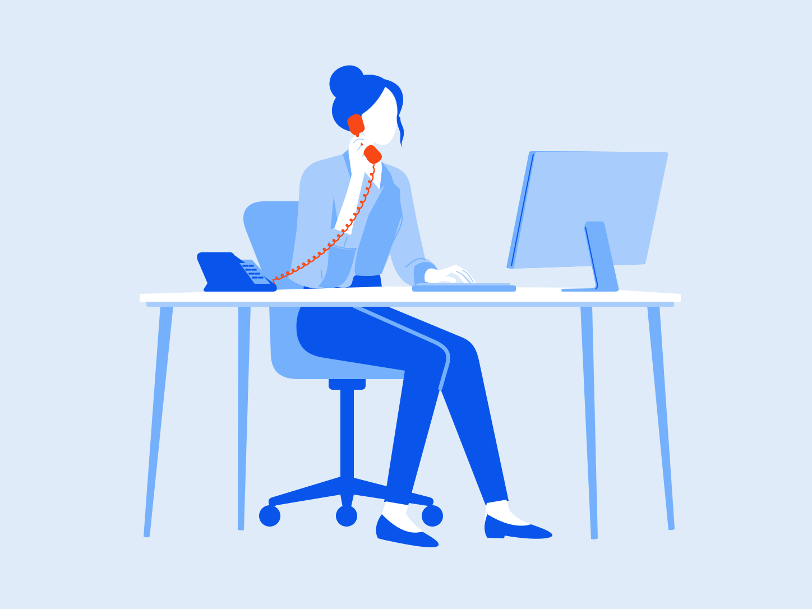
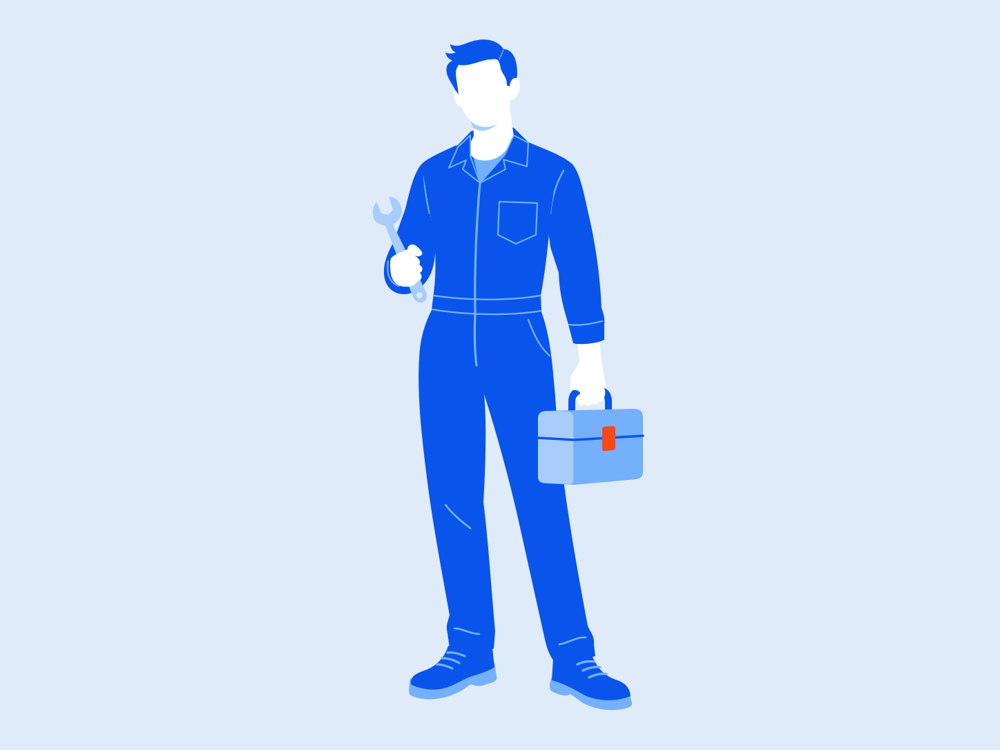
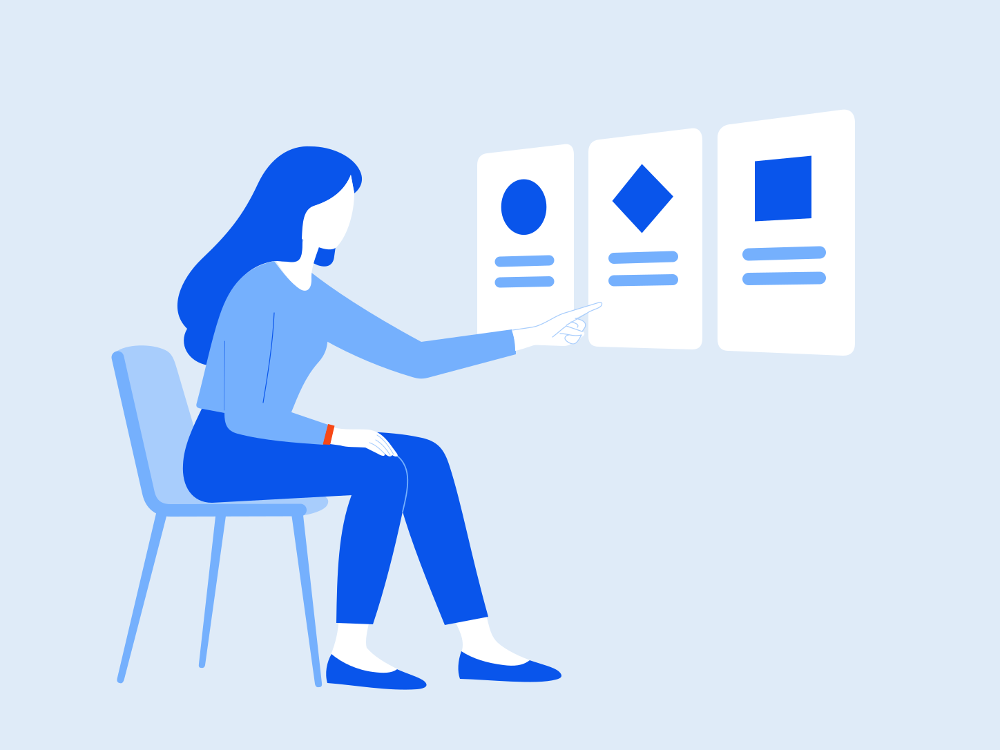

# GIO Illustration Style — Brand Guidelines Adaptation

Style updated 7 October 2026; GitHub edition published 9 November 2026.
This is the active illustration guide and replaces the former Marshmallow direction.

Use the illustration language in the supplied GIO brand-guideline PDF, recoloured with
the six existing project colours below. This replaces the former **Marshmallow** style.
Do not combine the old inflated shapes or expressive cartoon faces with the new style.

**Project finish override — 7 October 2026:** use pure, clean, solid-colour shapes.
No grain, noise, speckling, stippling or surface texture. This user-approved requirement
takes precedence over texture shown or described in the PDF and earlier sample images.
Keep the PDF-derived proportions, faceless characters and drawing language unchanged.

## Source and authority

Source: *GIO - Brand Guidelines v1 - Website Team - Not Final.pdf*, supplied for
this project. The source PDF and its page captures are not redistributed here.

Relevant pages, using **PDF page numbers** rather than the book's printed pagination:

- **53 — Illustration Style:** a current/suggested-adaptation comparison. Simplified
  lines, textures and detail support a clear hero subject; tonal blues and a warm accent
  organise the scene. The light-background adaptation adds definition to the objects.
  The page identifies that adaptation as a rough suggestion, not finished artwork.
- **54 — Illustration Character Style** (printed page 65): people have exaggerated,
  elongated limbs, no faces or facial expressions, and a speckled texture. Adopt the
  character construction, but omit its texture under the project finish override above.
- **55 — Illustration Animation** (printed page 66): movement is simple, refined and
  physically grounded, without exaggerated cartoon pops, bounces or whips.

The supplied PDF is labelled **Not Final**. This document is the requested project
adaptation of its illustration direction, not a claim of final brand-team approval.

Apply the PDF's **illustration sections**, not its photographic campaign, logo, web-icon,
typography or gradient-background treatments. Preserve the project's new palette instead
of importing the PDF's legacy blues, red, greys or other colours.

### Using the source references

PDF pages 53–55 are references for shapes, proportions and composition, not colour or
texture. Do not copy their grain or speckling. Their text, page layout, logos and
annotation colours are not part of a new illustration. The current project examples
below demonstrate the adapted palette and clean finish without redistributing the PDF.

### Superseded work

The [previous Marshmallow guide](gio-illustration-marshmallow-archive-2026-11-09.md)
is retained for historical reference. Its example images, prompts, dot eyes, line noses
and pill-shaped construction are **not current style instructions**. The clean solid
finish specified here is a new project override, not a return to Marshmallow geometry.
Existing image and SVG files are preserved, but must not be used as style references for
new work unless the user explicitly asks for that earlier direction.

## Style in one sentence

Create a refined, flat editorial illustration with simplified, recognisable silhouettes,
elongated faceless people, restrained graphic detail and pure solid-colour shapes, using
the project's cobalt/blue/white palette with a small orange-red accent.

## What changes, and what stays

- **Change:** inflated, uniformly rounded Marshmallow forms become leaner, flatter
  geometric and organic shapes with a mix of straight edges, gentle curves and purposeful
  angles.
- **Change:** dot eyes, line noses and smiles become completely featureless faces.
- **Change:** inflated plastic-like masses become clean layered graphic shapes without
  grain, speckling or surface texture.
- **Change:** broad capsule furniture and chunky figures become believable objects and
  elongated adult figures, with sparse defining lines.
- **Keep:** all six colour values, uncluttered composition, clear subject recognition,
  editable vector-friendly construction, and no unnecessary props.
- **Keep as project production defaults:** 4:3 framing and comfortable uncropped margins.
  These are project conventions, not claimed requirements from the PDF.
- **Keep:** no photographic rendering, glossy 3D, lighting gradients or heavy shadows.
- **Project override:** omit the PDF's speckled texture entirely. Pure shapes and solid
  fills are the required finish, not an optional texture-free export.

## Retained project palette

The hex values below are unchanged from the previous MD. Colour roles are adapted to
the PDF's flatter, more graphic style.

| Role | Colour | Hex |
| --- | --- | --- |
| Main structure, hair, clothing, defining lines | Cobalt blue | `#0955EB` |
| Secondary objects and clothing planes | Sky blue | `#75B0FD` |
| Light planes and secondary shape definition | Soft blue | `#A8CDFC` |
| Default light background | Pale blue-white | `#DFEBF8` |
| Faces, hands, light surfaces and negative space | White | `#FFFFFF` |
| Small focal accent, replacing the source's red | Warm orange-red | `#F74816` |

Use blue as the dominant family and white to separate forms. Keep orange-red concentrated
in one or a few meaningful details, normally a small proportion of the illustration.
Not every illustration needs all six colours.

For the default light-background treatment, use `#DFEBF8` and define pale objects with
selective cobalt or sky-blue edges. A cobalt-background treatment may be used when the
brief calls for it, with white and lighter blues providing separation.

Do not sample colours from raster references. Do not import navy, dark red, black,
neutral greys, greens, browns, skin-tone colours, or the PDF's magenta review annotations.
For depth, use separate overlapping shapes in approved solid colours, not gradients
or surface texture.

## Drawing language

### Flat shapes with selective definition

- Build a readable silhouette from a small number of flat filled shapes.
- Use straight architectural edges, tapered clothing, slim furniture and natural curves.
  Round a corner where the object warrants it; do not round every corner automatically.
- Maintain recognisable proportions of objects such as cars, desks, phones and buildings.
  Simplify their construction rather than turning them into inflated toys.
- Use selective thin lines for collars, sleeves, seams, door/window frames, furniture
  edges, branches or other recognition-critical features.
- Avoid a heavy uniform cartoon outline around every shape. Internal lines should support
  hierarchy, not produce dense technical drawings.
- Create depth through overlap and a few separate solid-colour planes. Keep perspective
  modest and scene-like, not a default isometric or glossy 3D treatment.
- Include enough detail to identify the subject and action; omit decorative clutter.
  The source's principle is restraint, not a mandatory fixed number of detail groups.

### People — elongated and faceless

- Use stylised adult proportions: a relatively small head, long slender arms and legs,
  a clear torso, and simple hands and feet. Exaggeration is elegant, not rubbery.
- Use natural working or conversational poses. Communicate attention, confidence and
  warmth through head angle, shoulders, hand gestures and posture.
- Heads are simple featureless shapes. **No eyes, eyebrows, nose, mouth, smile, cheeks,
  eyelashes or other facial expressions.** The earlier dot-eye/line-nose rule is retired.
- Hair is one simple graphic silhouette, not strands, glossy highlights or a large
  cartoon quiff. Keep the head distinct from the shoulders with a readable neck.
- Clothing uses broad graphic panels, believable collars or cuffs and sparse fold lines.
  Trousers may taper. Shoes are modest shapes, not oversized rounded sneakers.
- Hands can be simplified but must convincingly hold a handset or touch a keyboard.
- Vary body shape, hair and clothing across a series while maintaining the same slender,
  simplified visual language. Avoid stereotypes.
- Use only the retained palette; white or a light approved blue can represent exposed
  skin as an abstract brand treatment.

### Clean solid finish — no texture

The PDF uses speckling, but the user's 7 October 2026 feedback explicitly excludes it
from this project. Match the reference's shapes and proportions, not its surface finish.

- Every shape and background uses one uniform, opaque, solid colour from edge to edge.
- No grain, noise, speckles, stippling, scattered flecks, paper texture, sandpaper effect,
  distressed edges or texture overlays, even in small or isolated areas.
- Keep faces completely blank and all surfaces clean.
- Create separation with shape boundaries, selective defining lines and overlapping
  solid-colour planes, never with surface noise.
- No gradients, grey wash, transparency, glossy shading, blurred shadows, bevels or
  realistic lighting. A flat ground shape or an overlapping colour plane is acceptable.
- Do not reintroduce texture because it appears in a source reference or older sample.
- For SVGs, use clean editable paths and solid fills; do not add grain layers, texture
  patterns, filters or embedded raster effects.

## Scene and composition

- Default to a 4:3 landscape canvas, composed at that ratio rather than stretched.
- Show the full intended subject with roughly 12–15% clear space around it. Do not clip
  heads, hands, furniture, landmarks or important accessories.
- Prefer a simple scene or vignette with one readable action and a clear hero subject.
- Use a thin ground line, a restrained flat ground plane, or one simple contextual shape
  when it helps orient the scene. Do not automatically add a pill-shaped platform.
- Keep background context subordinate. A customer-service scene does not need houses,
  cars, trees, clouds, a map or a sun merely because they appear in a PDF example.
- Lean into Australian architecture, landscape, plants or wildlife only when natural
  to the brief. Australian character is contextual, not a requirement to add a cockatoo
  or tree to every illustration.
- Use a straight-on or gentle three-quarter scene view when suitable. A requested
  viewpoint, such as an oblique map, can override this default without changing style.
- No text, logos, watermarks, invented interface copy or brand lettering unless requested.

## Subject-specific guidance

### Customer service and office scenes

Use a slender faceless adult, attentive posture, a clear telephone/headset interaction
and just enough workstation context to establish the role. Use slim desk and chair
structures, simple rectangular monitor shapes and a few defining clothing lines.
Avoid an oversized smiling mascot face, plush furniture, large speech bubbles or
unrelated insurance props.

### Buildings and furniture

Preserve recognisable straight edges and proportions. Use broad facades, a few window
and door divisions, and selective line definition as seen in the PDF's light-background
adaptation. Furniture should look usable and lightweight, not like capsules or cushions.

### Vehicles and repair subjects

Use a simplified recognisable vehicle silhouette, restrained window/wheel divisions and
a clear working gesture when a person is present. Do not add dense mechanical detail.
Use a small orange-red focal detail in place of the PDF's red.

### Landscapes and supporting objects

Use simplified natural silhouettes, fine branch or contour lines only where useful,
and clean solid fills. Keep context sparse and relevant to the scene.

## Master generation prompt

```text
Create one original GIO brand-guideline-style illustration of [SUBJECT AND ACTION].

Follow the illustration guidance in gio-illustration.md, especially PDF page 54 for
characters and page 53 for flat object construction and selective definition. References
are for drawing language only, not their texture, old colours, typography, props or page
layouts. Ignore all grain and speckling visible in the PDF or previous samples.

Use flat editorial vector-like shapes, lean simplified silhouettes, a mix of straight
edges and natural curves, and sparse defining lines. Avoid the former inflated,
pill-shaped Marshmallow style. Keep objects believable and the action immediately clear.

For people: relatively small featureless heads, elongated slender adult limbs, simple
hair silhouettes, natural working posture, restrained clothing panels and small hands
and feet. Faces are completely blank: no eyes, eyebrows, nose, mouth or expressions.
Convey warmth and attentiveness through posture and gesture, not a smile.

Use only cobalt #0955EB, sky blue #75B0FD, soft blue #A8CDFC, pale blue-white #DFEBF8,
white #FFFFFF and a small orange-red #F74816 accent. Use the pale blue-white background
unless the brief requests another approved treatment. Recolour reference navy/red/grey
into this palette. Each base shape is a uniform opaque fill.

Use pure clean shapes and uniform opaque solid fills across every surface and the
background. NO grain, noise, speckles, stippling, scattered flecks, texture, paper effect
or sandpaper filter, even subtly or on selected shapes. No grey wash, gradients,
transparency, glossy lighting, shadows, bevels or photorealism.

Use a 4:3 landscape canvas with generous uncropped margins. One clear hero action and
only essential supporting context. No automatic clouds, birds, trees, map, sun, moon,
logos, text, page furniture or carryover props from previous illustrations.
```

## Sample subject brief — customer service representative answering the phone

```text
One professional customer service representative seated at a simple slim desk, holding
a telephone handset to their ear with one hand while the other rests near a keyboard.
Use an attentive slight forward lean and a relaxed head angle. Show the full seated
figure, chair, feet, desk and a simple desktop monitor. A small phone base on the desk
can connect to the handset through one restrained cord.

Make the person elongated and faceless, with a small blank white head, a simple cobalt
hair silhouette, a sky-blue collared shirt, cobalt trousers and modest shoes. Use the
orange-red handset as the focal accent. Keep the desk light, with selective blue edge
definition and slim straight legs. Use pure solid fills on the clothing, chair, monitor,
desk and background. No grain, speckling or other texture anywhere.
No other people, signage, speech bubbles, office decor or unrelated props.
```

## Current project examples

These examples show the current flat editorial direction with the retained palette and
clean solid finish. They are project examples, not a claim of final brand-team approval.
The previews below are rendered from the linked editable SVGs, so their colours and
surfaces follow the written rules exactly. Older generated PNGs may have subtle tonal
variation; the written colour values and native SVGs remain the production reference.

### Customer service representative answering the phone



[Editable SVG](gio-illustrations/assets/gio-customer-service-phone-clean.svg).
Use the elongated proportions, restrained desk construction and featureless head.

### Mechanic



[Editable SVG](gio-illustrations/assets/gio-mechanic-brand-guidelines.svg).
Use the lean silhouette, sparse clothing details and small orange toolbox latch.

### Customer choosing between three floating options



[Editable SVG](gio-illustrations/assets/gio-customer-choice-long-hair.svg).
The three cards are independent and unselected, with no enclosing blue panel.
The small orange accent sits on the customer's cuff, not on a selection badge.

### Control panel — floating sliders


[Editable SVG](gio-illustrations/assets/gio-control-panel-sliders.svg).
This example has no person or toggles. Two level, parallel panels float in front of the
phone; do not fan them or add bright blue panel outlines, shadows or glow.

### Earlier samples

Older Marshmallow examples remain available with the archived guide. The earlier
textured phone sample is superseded by the clean example above. Do not copy grain,
facial features or inflated construction from superseded work.

## SVG and animation preparation

- Rebuild accepted art with editable paths and simple shapes; do not embed a raster in
  an SVG and call it a vector conversion.
- Use as few anchors as necessary for smooth, faithful curves and clear straight edges.
- Separate background, context, furniture, person, hair/head, torso, arms/hands,
  legs/feet, phone and cord into meaningfully named groups when present.
- Use opaque solid fills with no grain layers, texture patterns or raster effects.
- If motion is requested, follow PDF page 55: smooth, restrained movement with believable
  timing and weight. No exaggerated bounces, rubbery limbs or distracting whip motions.
- Named layers help editing but are not a promise of a tested animation rig.

## Quality checklist

- [ ] The result follows the PDF's illustration language, not the old Marshmallow examples.
- [ ] The exact retained palette is specified; no legacy PDF colours or annotation colours.
- [ ] The silhouette and action read clearly at a small size.
- [ ] People have elongated limbs, a small head and a natural working posture.
- [ ] Faces are completely featureless; emotion comes from posture and gesture.
- [ ] Shapes mix clear straight edges with natural curves; no uniformly inflated capsules.
- [ ] Selective lines add definition without dense outlines or micro-detail.
- [ ] Every surface and the background use pure, uniform, opaque solid fills.
- [ ] There is no grain, noise, speckling, stippling, paper texture or distressed finish.
- [ ] There is no gradient, transparency, glossy 3D finish or grey haze.
- [ ] The complete subject fits the 4:3 canvas with comfortable clear margins.
- [ ] Context is relevant; no repeated unrelated motifs or accidental lettering.
- [ ] A generated sample is labelled as a sample until the user or brand team approves it.
